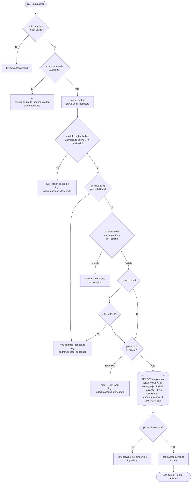

# Requerimiento 16 — US 05

## Título

Consultar el padrón de personal activo (RF-16 · US-05).

## Historia de usuario

**Como** analista de Recursos Humanos **quiero** consultar el padrón **para** atender cualquier trámite desde un solo lugar.

## Descripción

El backoffice de Recursos Humanos comparte únicamente la base de datos con el portal de empleados. Son dos despliegues distintos, con sesiones y políticas distintas. Esta plataforma no se abre por el solo hecho de ser empleado: exige un rol funcional habilitado para el módulo `rh_backoffice`.

El padrón es la vista de entrada al expediente. Responde una pregunta acotada: **qué personas están activas hoy**, en qué área están y con qué número de empleado se identifican. No es el expediente ni la ficha de una persona; es el listado paginado desde el cual se inicia cualquier trámite.

La lectura es de solo lectura. No crea, modifica ni elimina filas. Su riesgo principal no es la mutación, sino la **exposición de datos personales** y la **enumeración de registros fuera de alcance**. Por eso la consulta se resuelve con tres capas que no se reemplazan entre sí:

1. **Sesión**: token Bearer vigente, sin inactividad vencida.
2. **Módulo**: empleado activo y rol habilitado para `rh_backoffice`.
3. **Caso de uso**: capacidad `E-01` para listar y `E-12` para buscar, más el alcance de datos que la matriz de US-04 declare.

### Objetivo

Permitir que un usuario con rol de Recursos Humanos consulte un listado paginado de trabajadores activos, busque por nombre o número de empleado, y reciba únicamente los datos necesarios para iniciar un trámite, sin exponer registros dados de baja, datos personales innecesarios ni información fuera de su alcance.

### Alcance

Incluye:

- Listado paginado de empleados activos (`activo = true` y `fecha_baja = null`).
- Búsqueda por nombre parcial o por número de empleado exacto.
- Validación y sanitización de todos los parámetros de consulta.
- Orden estable por número de empleado e identificador interno.
- Aplicación del alcance de datos de la matriz de US-04 en la consulta y en el conteo.
- Auditoría estructurada de cada consulta exitosa, sin datos personales en claro.
- Registro de accesos denegados y de peticiones limitadas.
- Límite de consultas por usuario y respuesta `429`.
- Respuesta amigable ante indisponibilidad de base de datos.

No incluye:

- Ficha, detalle o edición de un trabajador (`E-02`, `E-04`).
- Alta, baja o reactivación de empleados (`E-03`, `E-05`, `E-06`, `E-07`).
- Exportación del padrón a CSV, Excel o PDF.
- Filtros por área, puesto, categoría o estado distintos de «activo».
- Ordenamiento configurable por columnas.
- Endpoint para consultar la auditoría desde la aplicación (`B-01`).
- Implementación de la pantalla o de sus cinco estados visuales; este repositorio es el backend.
- Prueba de carga formal para certificar el p95.

## Actores

La historia original usa los nombres `RRHH_ANALISTA` y `RRHH_ADMIN`. En este sistema no existen como roles: la matriz de US-04 los materializa en claves concretas. La equivalencia es la siguiente.

| Actor de la historia | Actor real en el sistema | Nivel de acceso | Acciones permitidas |
|---|---|---|---|
| Analista de RRHH / Secretaría | `SECRETARIA`, `SECRETARIA_CIRCULARES` | Autenticado y habilitado para `rh_backoffice` | Listar, buscar por nombre o número, navegar páginas. |
| Administrador de RRHH | `ADMIN` | Autenticado y habilitado para `rh_backoffice` | Las mismas acciones del analista. |
| Superadministrador | `SUPER_ADMIN` | Hereda las capacidades de `ADMIN` | Las mismas acciones. |
| Sistemas | `SISTEMAS` | Hereda las capacidades de `SUPER_ADMIN` | Las mismas acciones y, fuera de este requerimiento, lectura de logs técnicos. |
| Trabajador | Rol de portal, sin capacidad en el backoffice | Autenticado, pero sin privilegios de RRHH | Intento de acceso: `403`, sin datos y con registro del incidente. |
| Usuario no autenticado | Sin sesión | Restringido | `401`; el cliente redirige al inicio de sesión. |
| Administrador / Soporte técnico | `SISTEMAS` | Mantenimiento y auditoría | Consulta de logs y trazabilidad fuera de este endpoint. |

> **Regla de oro:** un permiso que solo se aplica en la interfaz no es un permiso. El listado, la búsqueda y el alcance se verifican en el servidor, aunque la interfaz oculte botones o el cliente invoque el endpoint directamente.

## Reglas de negocio

| ID | Categoría | Regla | Implementación |
|---|---|---|---|
| RN-01 | Validación | `buscar`, `pagina` y `por_pagina` se validan antes de consultar. Un término inválido produce `400`, identifica el campo y no ejecuta la consulta. | `ConsultarPadronRequest` + consultas Eloquent con bindings. |
| RN-02 | Cifrado / datos personales | Los datos del padrón solo viajan por HTTPS/TLS y nunca se escriben en logs en claro. | TLS en el proxy; respuesta limitada por `EmpleadoPadronResource`; auditoría con HMAC del filtro. |
| RN-03 | Idempotencia | `GET` no escribe filas ni produce efectos secundarios. La paginación es determinista. | `Empleado::query()` de solo lectura; orden `num_empleado`, `id`. |
| RN-04 | Rendimiento / monitoreo | El listado debe responder en ≤ 1 s (p95) y todo acceso debe quedar registrado. | Índices `idx_empleados_nombre` e `idx_empleados_padron`; log estructurado `padron.consulta`. |
| RN-05 | Autorización / alcance | Solo roles con capacidad en el backoffice acceden al padrón. El alcance se aplica en la consulta. | `auth:sanctum`, `modulo:rh_backoffice`, `permiso:E-01`, `E-12` para búsqueda y `AlcanceDeDatos`. |
| RN-06 | Estado del registro | Un trabajador está activo solo si `activo = true` y `fecha_baja` es nula. | `where('activo', true)->whereNull('fecha_baja')`. |
| RN-07 | Búsqueda | Un término compuesto solo por dígitos es un número de empleado exacto (máximo 20). Cualquier otro término es un nombre parcial (máximo 150, sin dígitos ni metacaracteres). | Detección en validación y rama en `ConsultarPadron`. |
| RN-08 | Paginación | `pagina` inicia en 1. `por_pagina` vale 20 por defecto y 100 como máximo. | `config/modulos.php` → `rh_backoffice.padron`. |
| RN-09 | Límite de consultas | Cada usuario puede ejecutar 60 consultas por minuto. Al superar el umbral, recibe `429` con `Retry-After`. | `RateLimiter` con llave por `usuario_id`. |
| RN-10 | Auditoría | La consulta exitosa registra usuario, rol, tipo de filtro, página, tamaño, total, IP y timestamp. El término no se guarda en claro. | `AuditarPadron::consultaExitosa`. |
| RN-11 | Acceso denegado | Un `403` o un `429` sobre `/api/padron` se registra como evento de auditoría. | Middleware `auditar.padron`. |

### Detalle de la búsqueda

| Entrada | Interpretación | Consulta | Ejemplo |
|---|---|---|---|
| Vacía o ausente | Sin filtro | Listado completo paginado. | `GET /api/padron` |
| Solo dígitos | Número de empleado | `num_empleado = término` | `buscar=1002` |
| Letras, espacios, apóstrofo, guion o punto | Nombre parcial | `nombre LIKE %término%` | `buscar=ana` |
| Dígitos y letras mezclados, `%`, `_`, `\`, `=`, comillas dobles u otro metacaracter | Inválido | `400` sin consultar | `buscar=1002A` |

La validación rechaza los metacaracteres antes de que lleguen al `LIKE`. Aun así, la consulta usa bindings; la protección contra inyección no depende de la validación.

## Criterios de aceptación

| ID | Escenario | Resultado esperado | Estado |
|---|---|---|---|
| AC-01 | Un analista autenticado accede al padrón con trabajadores activos y dados de baja. | Lista solo activos con `pagina`, `por_pagina`, `total` y `total_paginas`; no incluye bajas. | ✅ |
| AC-02 | Busca por nombre parcial o por número de empleado. | Devuelve coincidencias manteniendo la paginación y sin registros fuera de alcance. | ✅ |
| AC-03 | Un usuario con rol `TRABAJADOR` invoca `GET /api/padron`. | `403`, sin datos y con registro del incidente. | ✅ |
| AC-04 | Un usuario sin sesión invoca el endpoint. | `401`; el cliente redirige al login sin exponer información. | ✅ |
| AC-05 | Se supera el umbral de consultas configurado. | `429` con `Retry-After`; el servicio sigue disponible para el resto. | ✅ |
| AC-06 | Se envía un número de empleado con formato inválido. | `400`, `campo=buscar` y mensaje de corrección; la UI conserva lo ingresado. | ✅ |

Criterios adicionales verificados:

- [x] El listado no devuelve `correo_institucional`, `curp`, `fecha_nacimiento` ni otros datos personales.
- [x] El orden es determinista y dos páginas consecutivas no repiten ni omiten registros.
- [x] Una consulta con alcance `propio` solo devuelve el empleado vinculado al usuario.
- [x] La consulta exitosa produce un log `padron.consulta` sin el término en claro.
- [x] El acceso denegado produce un log `padron.acceso_denegado`.
- [x] El límite de consultas devuelve `429` sin ejecutar la consulta a la base.
- [x] La ruta declara `permiso:E-01` y la suite de cobertura de rutas sigue en verde.

## Flujo feliz

| Paso | Actor | Acción en la interfaz | Procesamiento del backend | Resultado |
|---|---|---|---|---|
| 1 | Analista de RRHH | Entra a «Padrón» desde el menú de RRHH. | `auth:sanctum` valida el token; `sesion.inactividad` renueva o vence la sesión; `modulo:rh_backoffice` valida empleado activo y rol; `permiso:E-01` resuelve la capacidad y el alcance. | La UI muestra el estado de carga. |
| 2 | Sistema | — | `ConsultarPadron` filtra activos, aplica el alcance en SQL y pagina en el servidor. | Tabla con número, nombre, área, estado y acciones. |
| 3 | Analista | Introduce un término y navega páginas. | `ConsultarPadronRequest` valida y sanitiza; se exige `E-12` si hay búsqueda; se ejecuta la consulta parametrizada. | Resultados filtrados con la misma paginación. |
| 4 | Sistema | — | Se construye la respuesta con `EmpleadoPadronResource` y se registra `padron.consulta`. | Tabla actualizada con total y páginas disponibles. |

La interfaz debe conservar el término ingresado cuando recibe `400`. El backend no repite el valor en la respuesta para no ampliar la superficie de exposición; la UI lo conserva en su estado local.

## Flujos alternativos y manejo de excepciones

| ID | Disparador | Comportamiento del backend | Respuesta | Severidad |
|---|---|---|---|---|
| EX-01 | `buscar` inválido, `pagina` o `por_pagina` fuera de rango. | `ConsultarPadronRequest` rechaza antes de consultar. | `400` con `mensaje`, `codigo` y `campo`. | Media |
| EX-02 | Se superan 60 consultas por minuto para el usuario. | `RateLimiter` bloquea antes de la consulta y el middleware de auditoría registra el evento. | `429` con `reintentar_en_segundos` y `Retry-After`. | Alta |
| EX-03 | Token vencido o sesión inactiva. | `auth:sanctum` o `sesion.inactividad` rechazan; no se entrega el padrón. | `401`; el cliente redirige al login. | Media |
| EX-04 | Base de datos o consulta no disponible. | Se captura `QueryException`, se registra `padron.consulta_fallida` y se devuelve un mensaje estable. | `503` con `codigo=servicio_no_disponible`. | Crítica |
| EX-05 | Usuario autenticado sin rol de backoffice, por ejemplo `TRABAJADOR`. | `modulo:rh_backoffice` devuelve `403`, destruye el token y no entrega datos; `auditar.padron` registra el intento. | `403` genérico. | Alta |
| EX-06 | Registro fuera del alcance del rol. | El endpoint no recibe un `id`, así que no existe una consulta puntual que dispare este caso. El alcance se aplica al listado completo. Para una futura ficha (`E-02`), la política de US-04 devuelve `404` idéntico al de un recurso inexistente, no `403`, para impedir la enumeración por prueba de existencia. | `404` en la futura ficha; no aplica al listado. | Alta |

## Diagrama de flujo



## Interfaz expuesta

| Método | Ruta | Autenticación | Caso de uso | Descripción |
|---|---|---|---|---|
| `GET` | `/api/padron` | Bearer obligatorio | `E-01`; `E-12` cuando hay búsqueda | Lista paginada del personal activo. |

La ruta declara `permiso:E-01`. La búsqueda se ejecuta dentro del mismo endpoint y exige además la capacidad `E-12`, que en la matriz actual comparten todos los roles del padrón. Si en el futuro un rol recibe `E-01` pero no `E-12`, podrá listar sin buscar y recibirá `403` al intentar una búsqueda.

### Parámetros de consulta

| Parámetro | Tipo | Obligatorio | Regla | Valor por defecto |
|---|---|---|---|---|
| `buscar` | string | No | Vacío = sin filtro. Solo dígitos = número de empleado exacto, máximo 20. Nombre parcial, máximo 150, sin dígitos ni metacaracteres. | Sin filtro |
| `pagina` | integer | No | ≥ 1 | `1` |
| `por_pagina` | integer | No | Entre 1 y 100 | `20` |

Configuración en `config/modulos.php`:

```php
'padron' => [
    'por_pagina' => 20,
    'max_por_pagina' => 100,
    'consultas_por_minuto' => 60,
],
```

### Petición

```http
GET /api/padron?buscar=ana&pagina=1&por_pagina=20 HTTP/1.1
Authorization: Bearer <token>
Accept: application/json
```

### Respuesta exitosa

```http
HTTP/1.1 200 OK
Content-Type: application/json
```

```json
{
    "datos": [
        {
            "id": 12,
            "num_empleado": "1002",
            "nombre": "Ana López",
            "area": {
                "id": 3,
                "nombre": "Dirección de Sistemas"
            },
            "estado": "Activo"
        }
    ],
    "meta": {
        "pagina": 1,
        "por_pagina": 20,
        "total": 1,
        "total_paginas": 1
    },
    "enlaces": {
        "anterior": null,
        "siguiente": null
    }
}
```

| Campo | Descripción |
|---|---|
| `datos[].id` | Identificador interno del empleado, usado por la UI para iniciar trámites. No es el número de empleado. |
| `datos[].num_empleado` | Número de empleado. |
| `datos[].nombre` | Nombre completo. |
| `datos[].area` | Área actual, o `null` si no tiene área asignada. |
| `datos[].estado` | `Activo`. El listado excluye bajas, por lo que no devuelve `Baja`. |
| `meta.pagina` | Página actual. |
| `meta.por_pagina` | Tamaño de página efectivo. |
| `meta.total` | Total de registros que cumplen el filtro y el alcance. |
| `meta.total_paginas` | Última página disponible. |
| `enlaces.anterior` / `enlaces.siguiente` | URL de navegación o `null` en los extremos. |

El recurso no devuelve `correo_institucional`, `curp`, `fecha_nacimiento`, `fecha_baja`, `motivo_baja`, `observaciones` ni ninguna otra columna del expediente. La lista de campos es una allowlist: si el modelo crece, la respuesta no crece con él.

### Respuesta de validación

```http
HTTP/1.1 400 Bad Request
Content-Type: application/json
```

```json
{
    "mensaje": "El criterio de búsqueda no es válido. Verifica el número de empleado o el nombre ingresado",
    "codigo": "criterio_busqueda_invalido",
    "campo": "buscar"
}
```

Para `pagina` o `por_pagina`:

```json
{
    "mensaje": "Los parámetros de consulta no son válidos.",
    "codigo": "parametros_invalidos",
    "campo": "por_pagina"
}
```

### Respuesta sin sesión

```http
HTTP/1.1 401 Unauthorized
Content-Type: application/json
```

```json
{
    "message": "Unauthenticated."
}
```

### Respuesta de rol no habilitado para el módulo

```http
HTTP/1.1 403 Forbidden
Content-Type: application/json
```

```json
{
    "mensaje": "Tu acceso a este módulo ya no está vigente."
}
```

El token del usuario se destruye. Un intento posterior con el mismo token recibe `401`.

### Respuesta de capacidad denegada

```json
{
    "mensaje": "No tienes permiso para esta acción.",
    "codigo": "permiso_denegado"
}
```

### Respuesta de límite de consultas

```http
HTTP/1.1 429 Too Many Requests
Retry-After: 42
Content-Type: application/json
```

```json
{
    "mensaje": "Has superado el límite de consultas permitido. Intenta de nuevo en unos minutos.",
    "codigo": "limite_consultas",
    "reintentar_en_segundos": 42
}
```

### Respuesta de indisponibilidad

```http
HTTP/1.1 503 Service Unavailable
Content-Type: application/json
```

```json
{
    "mensaje": "Servicio no disponible temporalmente. Intenta más tarde.",
    "codigo": "servicio_no_disponible"
}
```

## Comportamiento y códigos de respuesta

| Código | Cuándo | Efecto sobre el token | Auditoría |
|---|---|---|---|
| `200` | Consulta válida y autorizada. | Ninguno. | `padron.consulta` |
| `400` | Parámetro inválido. | Ninguno. | Sin evento de consulta; no se ejecutó la query. |
| `401` | Sin token, token inválido, vencido o sesión inactiva. | Ninguno, o destruido si fue inactividad. | El middleware de inactividad no registra evento de padrón. |
| `403` | Rol sin acceso al módulo o capacidad denegada. | Destruido si el módulo no está vigente; conservado si solo falta la capacidad. | `padron.acceso_denegado` |
| `429` | Se superó el límite de consultas. | Ninguno. | `padron.acceso_denegado` |
| `503` | Falló la consulta a la base. | Ninguno. | `padron.consulta_fallida` (crítica) |

## Auditoría y trazabilidad

La bitácora (`bitacora`) se reserva para mutaciones. Una consulta es una lectura y no se escribe allí, porque US-04 establece que la bitácora registra cambios y no lecturas.

La trazabilidad de esta historia se resuelve con log estructurado:

| Evento | Nivel | Campos |
|---|---|---|
| `padron.consulta` | `info` | `usuario_id`, `rol`, `modulo`, `filtro` (`ninguno`, `nombre`, `num_empleado`), `longitud_filtro`, `filtro_huella`, `pagina`, `por_pagina`, `total_resultados`, `ip`, `timestamp`. |
| `padron.acceso_denegado` | `warning` | `usuario_id`, `rol`, `modulo`, `metodo`, `ruta`, `codigo`, `ip`, `timestamp`. |
| `padron.consulta_fallida` | `critical` | `usuario_id`, `sqlstate`, `timestamp`. |

`filtro_huella` es un HMAC-SHA256 truncado del término normalizado. Permite correlacionar consultas repetidas sin guardar el nombre ni el número de empleado en claro. El log no incluye SQL, bindings ni resultados.

El actor «Administrador / Soporte técnico» consulta estos eventos desde la infraestructura de logs. Un endpoint de consulta de auditoría (`B-01`) no forma parte de esta historia.

## Consideraciones de seguridad

- **Doble capa de autorización.** El middleware `modulo:rh_backoffice` valida que el empleado siga activo y que el rol siga habilitado; `permiso:E-01` valida la capacidad. Un `403` de capacidad no destruye el token, porque el usuario está legítimamente autenticado. Un `403` de módulo sí lo destruye, porque la relación laboral o el rol ya no están vigentes.
- **Alcance en SQL.** `AlcanceDeDatos` se aplica antes del `paginate()`. El total y la página usan el mismo scope. Filtrar después de paginar permitiría que el conteo revelara la existencia de registros fuera de alcance.
- **Sin PII en logs.** El término de búsqueda no se escribe. La respuesta usa un recurso con allowlist. La consulta fallida no registra SQL ni bindings.
- **Consultas parametrizadas.** El filtro se expresa con el query builder de Eloquent; no se concatenan valores en SQL. La validación adicional de caracteres es defensa en profundidad.
- **Wildcards neutralizados.** El nombre se busca con `LIKE`, pero la validación rechaza `%`, `_` y `\`; el usuario no puede convertir un nombre en un patrón.
- **Búsqueda numérica exacta.** El número de empleado usa igualdad y no un rango o `LIKE` con comodín inicial, lo que aprovecha el índice único y evita escaneos innecesarios.
- **TLS obligatorio.** El cifrado en tránsito se termina en el proxy. La aplicación no sirve el padrón por HTTP plano en producción.
- **Límite por usuario.** La llave del `RateLimiter` incluye `usuario_id`, no solo la IP. Un usuario autenticado no puede eludir el límite cambiando de red.
- **Respuesta de error estable.** Un fallo de base devuelve `503` sin detalles internos. El detalle queda en el log crítico.
- **Sin `id` en la ruta.** Este endpoint no permite consultar una persona por identificador; por eso no hay enumeración por `id` en esta historia. La ficha puntual es `E-02` y debe aplicar la política de `404` de US-04.

## Rendimiento

| Medida | Implementación |
|---|---|
| Índice por nombre | `idx_empleados_nombre` sobre `empleados.nombre`. |
| Índice del listado activo | `idx_empleados_padron` sobre `(activo, fecha_baja, num_empleado)`. |
| Índice del número | El `unique` existente sobre `num_empleado` cubre la búsqueda exacta. |
| Conteo | `paginate()` ejecuta el conteo con el mismo query y el mismo alcance. |
| Orden | `num_empleado`, `id`; determinista y compatible con el índice del listado. |
| Tamaño de página | 20 por defecto, 100 máximo, para acotar la respuesta. |

La prueba de carga para certificar el p95 ≤ 1 s no forma parte de esta entrega. Los índices y el límite de página son la base para cumplir el SLA; la medición formal queda pendiente.

## Estado de implementación

| Pieza | Archivo |
|---|---|
| Ruta | `routes/api.php` |
| Alias `auditar.padron` | `bootstrap/app.php` |
| Validación y `400` | `app/Http/Requests/ConsultarPadronRequest.php` |
| Controlador | `app/Http/Controllers/Api/ConsultarPadronController.php` |
| Consulta y alcance | `app/Services/Padron/ConsultarPadron.php` |
| Auditoría estructurada | `app/Services/Padron/AuditarPadron.php` |
| Auditoría de denegados | `app/Http/Middleware/AuditarAccesoPadron.php` |
| Respuesta acotada | `app/Http/Resources/EmpleadoPadronResource.php` |
| Modelo de área | `app/Models/AreaUtn.php` |
| Configuración | `config/modulos.php` → `rh_backoffice.padron` |
| Índices | `database/migrations/2026_11_09_000000_add_padron_indexes_to_empleados_table.php` |
| Pruebas | `tests/Feature/ConsultarPadronTest.php` |

Resultado de la suite completa: **77 pruebas, 635 aserciones, todas en verde**; Pint sin observaciones.

Pruebas de esta historia: **12 pruebas, 56 aserciones**.

| Prueba | Qué verifica |
|---|---|
| Listado con metadatos | Solo activos, paginación y allowlist de campos. |
| Paginación estable | Sin duplicados ni omisiones entre páginas. |
| Búsqueda por nombre | Coincidencia parcial, paginación y total filtrado. |
| Búsqueda por número | Coincidencia exacta. |
| Criterio inválido | `400`, campo identificado y sin datos. |
| Intento de inyección | Rechazo por validación; la tabla no cambia. |
| Paginación inválida | `400` y `codigo=parametros_invalidos`. |
| Sin token | `401`. |
| Trabajador | `403`, token destruido y evento de auditoría. |
| Límite de consultas | `429` y `Retry-After`. |
| Auditoría exitosa | `padron.consulta` sin el término en claro. |
| Alcance propio | Solo el empleado vinculado al usuario. |

## Relación con requerimientos anteriores

| Momento | Requerimiento | Efecto |
|---|---|---|
| Inicio de sesión | RF-01 · US-01 | Emite el token con módulo y rol; el padrón exige ese token. |
| Uso de la sesión | RF-01 · US-01 | Revalida empleado activo y rol habilitado. |
| Cierre explícito | RF-02 · US-02 | Destruye el token de la petición actual. |
| Inactividad | RF-02 · US-03 | Destruye el token tras 30 minutos sin actividad. |
| Autorización por caso | RF-03 · US-04 | Resuelve `E-01`, `E-12` y el alcance de datos que consume este endpoint. |
| Consulta del padrón | RF-16 · US-05 | Primer consumidor de la matriz: lista y busca sin mutar datos. |

RF-01 responde «¿quién eres y puedes entrar?». RF-02 responde «¿tu sesión sigue viva?». RF-03 · US-04 responde «¿qué puedes hacer y sobre qué datos?». RF-16 · US-05 responde «¿qué personal activo hay y puedo consultarlo?».

## Decisiones cerradas

| ID | Decisión |
|---|---|
| D-1 | El listado usa el caso `E-01`; la búsqueda exige además `E-12`. Hoy todos los roles del padrón tienen ambos, pero la separación se conserva para que la matriz pueda divergir sin reescribir el endpoint. |
| D-2 | `estado` se devuelve como texto `Activo`. El listado excluye bajas, así que `Baja` no aparece en esta respuesta. |
| D-3 | La búsqueda numérica es exacta, no parcial. Un número de empleado es un identificador, no un nombre. |
| D-4 | El término de búsqueda no se registra en claro. La auditoría guarda tipo, longitud y HMAC. |
| D-5 | `EX-06` no se dispara en este endpoint porque no recibe `id`. Para la futura ficha se mantiene el `404` de US-04, no el `403` de la narrativa original, para no revelar existencia. |
| D-6 | Los accesos denegados y los límites se auditan en log estructurado, no en `eventos_auth`. Agregar un tipo al enum requeriría una migración y US-04 dejó esa extensión fuera de alcance. |
| D-7 | La bitácora no registra lecturas. La trazabilidad de esta historia vive en logs de aplicación. |

## Trabajo futuro (fuera de alcance)

- Pantalla de padrón y sus cinco estados visuales (ideal, vacío, carga, parcial, error) en el frontend.
- Exportación del padrón con control de permisos y auditoría.
- Filtros por área, puesto, categoría y tipo de jornada.
- Ordenamiento configurable con una allowlist de columnas.
- Endpoint de consulta de auditoría (`B-01`) para `SUPER_ADMIN` y `SISTEMAS`.
- Ficha del trabajador (`E-02`) con la política de `404` de US-04.
- Prueba de carga formal para certificar el p95 ≤ 1 s.
- Purga o retención definida para los logs de auditoría.
- Caché de la primera página si el volumen del padrón lo justifica, invalidada por alta, baja o edición.
