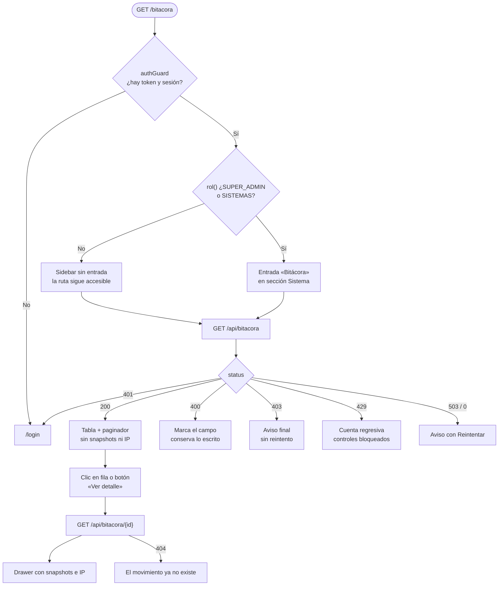

# Requerimiento B-01 — Bitácora

> **Estado: implementación frontend completada en esta rama.** Este documento fue el plan de desarrollo de la
> pantalla y el contrato que consumirá. No describe código existente: hoy el frontend no
> tiene ruta, servicio ni componente de bitácora. Cuando la pantalla exista, su documento
> de módulo (`docs/modulos/bitacora.md`) se escribe contra el código y este archivo queda
> como autoridad de producto.

## Título

Consultar la bitácora de movimientos del backoffice (B-01).

## Historia de usuario

**Como** responsable de auditoría del backoffice **quiero** consultar los movimientos
registrados en la bitácora con filtros y paginación **para** reconstruir qué ocurrió, quién
lo hizo y cuándo, sin recorrer la tabla completa.

## Descripción

La tabla `bitacora` registra las mutaciones del backoffice: altas, bajas, ediciones, cambios
de adscripción y ajustes de catálogos. La pantalla de bitácora es la lectura transversal de
esos movimientos. No es el historial de un trabajador ni un panel de indicadores: es un
listado paginado con filtros acotados y un detalle por movimiento.

La lectura es de solo lectura. No crea, modifica ni elimina filas. Su riesgo principal no es
la mutación, sino la **exposición de datos personales** —los snapshots `datos_antes` y
`datos_despues`, y la IP— y la **lectura masiva sin control**. Por eso el backend resuelve
tres capas que el frontend no reemplaza:

1. **Sesión**: token Bearer vigente, sin inactividad vencida.
2. **Módulo**: empleado activo y rol habilitado para `rh_backoffice`.
3. **Caso de uso**: capacidad `B-01`, reservada a `SUPER_ADMIN` y heredada por `SISTEMAS`.

El frontend solo decide **cómo se ve y cómo se consulta**. La autorización, la ventana de
fechas por defecto, la validación definitiva y el límite de consultas viven en el backend.
Ocultar la entrada del menú es comodidad, no seguridad.

### Objetivo

Permitir que un usuario con capacidad `B-01` consulte la bitácora de forma paginada, la
filtre por módulo, acción, correo, nombre y rango de fechas, cambie el sentido del orden y abra
el detalle de un movimiento para revisar sus snapshots y su IP, sin exponer más información
de la necesaria.

### Alcance

Incluye:

- Ruta `/bitacora` dentro del `AppShell`, con entrada en la sección «Sistema» del sidebar.
- Listado paginado de movimientos (`GET /api/bitacora`).
- Filtros exactos por `modulo` y `accion`; búsqueda del actor por `correo`.
- Búsqueda parcial solo por nombre histórico del usuario (la descripción ya no es criterio).
- Rango de fechas inclusivo, expresado como días del calendario local.
- Orden `asc` / `desc` con valor por defecto `desc`.
- Paginación con `pagina` y `por_pagina`, sin contadores agregados.
- Detalle de un movimiento (`GET /api/bitacora/{id}`) en un drawer, con snapshots e IP.
- Sincronización de filtros, orden y página con la URL, salvo `buscar`.
- Estados de carga, vacío, error, `403`, `429`, `401`, `404` y `503`.
- Pruebas unitarias del servicio, del mapeo de errores y de la sincronización con la URL.

No incluye:

- Escritura, corrección o borrado de registros de bitácora.
- Exportación a CSV, Excel o PDF.
- Filtros por empleado afectado, IP o contenido de los snapshots JSON.
- Catálogo cerrado de módulos y acciones: ambos se eligen en un selector; los códigos nuevos que lleguen en la URL se conservan como opción «Código: …».
- Contadores agregados por módulo, acción o usuario.
- Etiquetas legibles para `modulo`; la pantalla muestra el código crudo del módulo.
- Consulta de logs técnicos (`bitacora.consulta`, `bitacora.acceso_denegado`, etc.).
- Retención, purga o archivado de la bitácora.

## Actores

La política vigente de `config/permisos.php` declara `B-01` solo para `SUPER_ADMIN`;
`SISTEMAS` hereda la capacidad de `SUPER_ADMIN`. `ADMIN`, `SECRETARIA` y
`SECRETARIA_CIRCULARES` no la tienen.

| Actor | Actor real en el sistema | Nivel de acceso | Acciones permitidas |
|---|---|---|---|
| Superadministrador | `SUPER_ADMIN` | Capacidad `B-01` directa | Listar, filtrar, buscar, paginar, ordenar y abrir el detalle. |
| Sistemas / auditoría | `SISTEMAS` | Hereda `SUPER_ADMIN` | Las mismas acciones. |
| Administrador del backoffice | `ADMIN` | Sin `B-01` | No ve la entrada del menú; si entra por URL, recibe `403`. |
| Secretaría | `SECRETARIA`, `SECRETARIA_CIRCULARES` | Sin `B-01` | No ve la entrada del menú; si entra por URL, recibe `403`. |
| Usuario no autenticado | Sin sesión | Restringido | `401`; el interceptor limpia la sesión y el cliente redirige al login. |

> **Regla de oro:** la capacidad se verifica en el servidor. El frontend no tiene matriz de
> permisos propia: `AuthService.rol()` devuelve el rol de la sesión y solo se usa para
> mostrar u ocultar la entrada del menú. El `403` de la ruta sigue siendo la autoridad.

## Reglas de negocio

| ID | Categoría | Regla | Dónde se cumple |
|---|---|---|---|
| RN-01 | Validación | Todos los parámetros se validan antes de consultar. Un valor inválido produce `400`, identifica el campo y no ejecuta la consulta. | Backend; el frontend valida lo mismo antes de enviar para dar feedback inmediato. |
| RN-02 | Datos personales | El listado no expone snapshots JSON ni IP. Solo el detalle los entrega. El texto buscado nunca se guarda en claro. | Backend; el frontend no debe inventar esos campos en la tabla. |
| RN-03 | Idempotencia | `GET` no escribe filas y la paginación es determinista. | Backend; el frontend solo lee. |
| RN-04 | Rendimiento | El listado debe responder en ≤ 1 s (p95) y todo acceso queda registrado. | Backend; el frontend pagina en servidor, sin traer bloques gigantes. |
| RN-05 | Autorización | Solo roles con `B-01` acceden al listado y al detalle. | Backend (`permiso:B-01`); el sidebar oculta la entrada a los demás. |
| RN-06 | Ventana de fechas | Sin fechas se consultan los últimos 30 días. El rango es inclusivo y se interpreta en `America/Mexico_City`. | Backend. La pantalla no envía fechas si el usuario no las eligió. |
| RN-07 | Búsqueda | `buscar` es parcial solo sobre `usuario_historico`, máximo 150 caracteres. Los comodines SQL se escapan con `!`. | Backend; el frontend no escapa nada, solo recorta y valida longitud. |
| RN-08 | Filtros | `modulo` y `accion` se comparan por igualdad y aceptan `[A-Za-z0-9._-]`. `correo` resuelve al usuario antes de filtrar. | Backend; el frontend valida el patrón y los largos 100 / 50 / 150. |
| RN-09 | Paginación | `pagina` inicia en 1. `por_pagina` vale 20 por defecto y 100 como máximo. | Backend; el paginador ofrece 10, 20, 50 y 100. |
| RN-10 | Orden | `orden` acepta `asc` o `desc`; por defecto `desc`. Siempre desempata por `id` en el mismo sentido. | Backend; la pantalla ofrece un control de dos valores. |
| RN-11 | Detalle | Un `id` inexistente devuelve `404` con `codigo=no_encontrado`. | Backend; el drawer muestra el mensaje y permite volver al listado. |
| RN-12 | Límite de consultas | Listado y detalle comparten 60 consultas por minuto por usuario. Al superarlo, `429` con `Retry-After`. | Backend; el frontend muestra la cuenta regresiva y bloquea los controles. |
| RN-13 | Auditoría | La consulta exitosa, el detalle y el acceso denegado se registran en log estructurado. La bitácora no registra sus propias lecturas. | Backend; la pantalla no escribe nada. |
| RN-14 | Sin contadores | La respuesta no incluye agregados por módulo, acción o usuario. Solo `meta.total`, necesario para paginar. | Backend; el frontend no dibuja pestañas ni tarjetas con cifras. |

### Detalle de los filtros

| Parámetro | Interpretación | Consulta | Ejemplo |
|---|---|---|---|
| Ausente o vacío | Sin filtro | Todas las filas de la ventana. | `GET /api/bitacora` |
| `modulo=expediente` | Coincidencia exacta | `modulo = 'expediente'` | Movimientos de expediente. |
| `accion=empleado.baja` | Coincidencia exacta | `accion = 'empleado.baja'` | Solo bajas. |
| `correo=ana@utn.edu.mx` | Correo del actor | Resolver usuario y filtrar por su ID | Movimientos de ese usuario. |
| `buscar=Ana` | Parcial, sin distinguir mayúsculas según la colación | `usuario_historico LIKE %Ana%` | Coincidencias solo por nombre. |
| `buscar=50%` | Parcial literal | `LIKE %50!%% ESCAPE '!'` | Busca el texto `50%`, no un comodín. |
| `fecha_desde` / `fecha_hasta` | Días completos en `America/Mexico_City` | `fecha >= desde 00:00 UTC-6 AND fecha < hasta+1 00:00 UTC-6` | `2026-11-10` a `2026-11-10` cubre ese día local. |

La búsqueda **no** entra a los snapshots JSON, no filtra por IP y no filtra por empleado
afectado. Es una búsqueda de texto sobre el nombre histórico congelado del actor y la
descripción del movimiento.

## Criterios de aceptación

Criterios del contrato, ya verificados en el backend:

| ID | Escenario | Resultado esperado |
|---|---|---|
| AC-01 | Un usuario con `B-01` consulta sin filtros. | Movimientos de los últimos 30 días, del más reciente al más viejo, con `pagina`, `por_pagina`, `total` y `total_paginas`. |
| AC-02 | Filtra por módulo, acción o usuario. | Solo coincidencias exactas, con la paginación conservada. |
| AC-03 | Busca por nombre histórico o descripción. | Coincidencias parciales; los comodines se buscan literalmente. |
| AC-04 | Consulta un rango de un solo día local. | Incluye desde las 00:00 hasta las 23:59:59 de `America/Mexico_City`. |
| AC-05 | Solicita `orden=asc`. | Del más viejo al más nuevo, con desempate por `id`. |
| AC-06 | Navega a la segunda página. | `meta.pagina=2`, sin duplicados ni omisiones, y `enlaces.anterior` presente. |
| AC-07 | Abre el detalle de un movimiento. | Devuelve `datos_antes`, `datos_despues` e `ip` además de los campos del listado. |
| AC-08 | Abre un detalle inexistente. | `404` con `codigo=no_encontrado`. |
| AC-09 | Un `ADMIN` sin `B-01` invoca el endpoint. | `403` con `codigo=permiso_denegado`; el token no se destruye. |
| AC-10 | Un usuario sin sesión invoca el endpoint. | `401`; no se entrega información. |
| AC-11 | Se supera el límite de consultas. | `429` con `codigo=limite_consultas`, `reintentar_en_segundos` y `Retry-After`. |
| AC-12 | Se envía un parámetro inválido. | `400` con `codigo=parametros_invalidos` o `criterio_busqueda_invalido` y `campo`. |

Criterios de la pantalla, a verificar cuando se implemente:

| ID | Escenario | Resultado esperado | Estado |
|---|---|---|---|
| AC-F01 | Un `SUPER_ADMIN` o `SISTEMAS` entra a `/bitacora`. | Ve el listado de los últimos 30 días, orden descendente y la ventana explicada en el subtítulo. | ✅ |
| AC-F02 | Un `ADMIN` o `SECRETARIA` mira el sidebar. | No ve la entrada «Bitácora». | ✅ |
| AC-F03 | Un rol sin `B-01` entra a `/bitacora` por URL. | La pantalla muestra el `403` con un mensaje final, sin botón de reintentar. | ✅ |
| AC-F04 | El usuario escribe un correo sin `@` o un módulo con `%`. | El campo explica el formato y no se envía la consulta. | ✅ |
| AC-F05 | El usuario cambia cualquier filtro. | La página vuelve a 1 y la tabla se recarga una sola vez. | ✅ |
| AC-F06 | El usuario escribe en «Buscar». | La consulta sale tras 300 ms de silencio, sin meter el término en la URL. | ✅ |
| AC-F07 | El usuario cambia el orden. | La página vuelve a 1 y el listado se invierte con desempate estable. | ✅ |
| AC-F08 | El usuario abre un movimiento. | El drawer muestra snapshots e IP en formato legible (sin código/JSON crudo); el listado no los mostró antes. | ✅ |
| AC-F09 | El detalle responde `404`. | El drawer explica que el movimiento ya no existe y ofrece cerrar y recargar. | ✅ |
| AC-F10 | La API responde `429`. | El aviso muestra la cuenta regresiva y todos los controles quedan deshabilitados hasta que termine. | ✅ |
| AC-F11 | La API responde `503` o no hay red. | El aviso ofrece «Reintentar» sin perder los filtros ni la página. | ✅ |
| AC-F12 | El usuario recarga con filtros en la URL. | La pantalla abre con esos filtros, esa página y ese orden. | ✅ |
| AC-F13 | El usuario limpia los filtros. | La URL vuelve a `/bitacora` y se consulta la ventana por defecto. | ✅ |
| AC-F14 | El usuario abre los filtros «Módulo» y «Acción». | Ve catálogos legibles en vez de códigos; la consulta y la apertura de movimientos ya no aparecen en el catálogo de acciones. | ✅ |
| AC-F15 | El usuario mira la tabla. | No hay columna «Acción»; «Descripción» muestra el nombre de la acción («Alta de empleado»), con el texto original en `title`. | ✅ |
| AC-F16 | El usuario filtra por correo. | El parámetro `correo` viaja al backend en lugar de `usuario_id`. | ✅ |

## Flujo feliz

| Paso | Actor | Acción en la interfaz | Procesamiento del backend | Resultado |
|---|---|---|---|---|
| 1 | Auditor | Entra a «Bitácora» desde la sección «Sistema». | `auth:sanctum` valida el token; `sesion.inactividad` renueva o vence; `modulo:rh_backoffice` valida empleado y rol; `permiso:B-01` resuelve la capacidad. | La pantalla muestra el esqueleto de carga. |
| 2 | Sistema | — | `ConsultarBitacoraRequest` aplica la ventana de 30 días y valida parámetros; `ConsultarBitacora` filtra y pagina. | Tabla con fecha, nombre, módulo y descripción genérica de la acción. |
| 3 | Auditor | Ajusta filtros, busca texto, cambia de página u ordena. | La consulta usa bindings, escapa comodines y conserva el orden determinista. | Resultados filtrados con la misma paginación. |
| 4 | Sistema | — | Se responde con `BitacoraListadoResource` y se registra `bitacora.consulta`. | Tabla actualizada con total y páginas disponibles. |
| 5 | Auditor | Abre un movimiento. | `GET /api/bitacora/{id}` busca el registro y registra `bitacora.detalle`. | Drawer con snapshots e IP. |

## Flujos alternativos y manejo de excepciones

| ID | Disparador | Comportamiento del backend | Lo que hace la pantalla |
|---|---|---|---|
| EX-01 | Parámetro inválido: fecha mal formada, rango invertido, `por_pagina` fuera de rango, `orden` desconocido o `modulo`/`accion` con caracteres no permitidos. | `400` con `mensaje`, `codigo` y `campo`. | Conserva lo escrito, marca el campo con `campo` y muestra el mensaje del backend. |
| EX-02 | `buscar` no es UTF-8 válido o contiene caracteres de control. | `400` con `codigo=criterio_busqueda_invalido`. | Marca el campo «Buscar» y conserva el término. |
| EX-03 | Se superan 60 consultas por minuto del mismo usuario. | `429` con `reintentar_en_segundos` y `Retry-After`. | Muestra la cuenta regresiva, deshabilita filtros y paginador, y reintenta solo si el usuario lo pide al terminar. |
| EX-04 | Token vencido o sesión inactiva. | `401`. | El interceptor limpia la sesión; el aviso ofrece «Iniciar sesión». |
| EX-05 | Usuario autenticado sin `B-01`, por ejemplo `ADMIN`. | `403` con `codigo=permiso_denegado`; el token se conserva. | Aviso final: «No tienes permiso para consultar la bitácora». Sin reintento. |
| EX-06 | Registro de bitácora inexistente. | `404` con `codigo=no_encontrado`. | El drawer explica que el movimiento ya no existe y ofrece cerrar y recargar el listado. |
| EX-07 | Base de datos o consulta no disponible. | `503` con `codigo=servicio_no_disponible`. | Aviso con «Reintentar», sin perder filtros ni página. |
| EX-08 | La red no llega al servidor (`status=0`). | No hay respuesta. | Aviso de conexión con «Reintentar». |

## Diagrama de flujo de la pantalla



## Interfaz expuesta

| Método | Ruta | Autenticación | Caso de uso | Descripción |
|---|---|---|---|---|
| `GET` | `/api/bitacora` | Bearer obligatorio | `B-01` | Lista paginada de movimientos. |
| `GET` | `/api/bitacora/{id}` | Bearer obligatorio | `B-01` | Detalle de un movimiento con snapshots e IP. |

Ambas rutas comparten la cadena `auth:sanctum`, `sesion.inactividad`, `auditar.bitacora`,
`modulo:rh_backoffice`, `permiso:B-01` y `limitar.bitacora`. El token lo adjunta
`authInterceptor`; la pantalla nunca lo manipula.

### Parámetros de consulta del listado

| Parámetro | Tipo | Obligatorio | Regla | Valor por defecto |
|---|---|---|---|---|
| `modulo` | string | No | Máximo 100. Solo `[A-Za-z0-9._-]`. Coincidencia exacta. | Sin filtro |
| `accion` | string | No | Máximo 50. Solo `[A-Za-z0-9._-]`. Coincidencia exacta. | Sin filtro |
| `correo` | string | No | Correo válido, máx. 150. El backend resuelve el usuario. | Sin filtro |
| `buscar` | string | No | Máximo 150. Parcial solo sobre `usuario_historico`. | Sin filtro |
| `fecha_desde` | string | No | `Y-m-d`. Inclusiva, en `America/Mexico_City`. | Hace 29 días |
| `fecha_hasta` | string | No | `Y-m-d`, mayor o igual a `fecha_desde`. Inclusiva. | Hoy |
| `orden` | string | No | `asc` o `desc`. | `desc` |
| `pagina` | integer | No | ≥ 1. | `1` |
| `por_pagina` | integer | No | Entre 1 y 100. | `20` |

Si solo llega `fecha_hasta`, la ventana conserva los 30 días y termina en esa fecha. Si solo
llega `fecha_desde`, el rango termina hoy; una fecha inicial futura se consulta como ese
único día.

### Petición

```http
GET /api/bitacora?modulo=expediente&accion=empleado.baja&buscar=Ana&fecha_desde=2026-11-01&fecha_hasta=2026-11-19&orden=desc&pagina=1&por_pagina=20 HTTP/1.1
Authorization: Bearer <token>
Accept: application/json
```

### Respuesta exitosa del listado

```json
{
    "datos": [
        {
            "id": 481,
            "fecha": "2026-11-18T18:42:11+00:00",
            "usuario_id": 12,
            "usuario_historico": "Ana López",
            "accion": "empleado.baja",
            "modulo": "expediente",
            "descripcion": "Baja definitiva del trabajador 1002."
        }
    ],
    "meta": {
        "pagina": 1,
        "por_pagina": 20,
        "total": 1,
        "total_paginas": 1
    },
    "enlaces": {
        "anterior": null,
        "siguiente": null
    }
}
```

| Campo | Descripción |
|---|---|
| `datos[].id` | Identificador interno del movimiento. |
| `datos[].fecha` | Fecha del movimiento en ISO-8601 UTC. |
| `datos[].usuario_id` | Identificador del usuario que ejecutó la acción, o `null` si fue el sistema. |
| `datos[].usuario_historico` | Nombre del actor congelado al momento del movimiento. |
| `datos[].accion` | Código crudo de la acción, por ejemplo `empleado.baja`. Sin etiqueta legible. |
| `datos[].modulo` | Código crudo del módulo, por ejemplo `expediente`. Sin etiqueta legible. |
| `datos[].descripcion` | Texto descriptivo del movimiento. |
| `meta.pagina` | Página actual. |
| `meta.por_pagina` | Tamaño de página efectivo. |
| `meta.total` | Total de registros que cumplen los filtros. |
| `meta.total_paginas` | Última página disponible. |
| `enlaces.anterior` / `enlaces.siguiente` | URL de navegación o `null` en los extremos. |

El listado no devuelve `datos_antes`, `datos_despues` ni `ip`, y no incluye un bloque
`contadores`. La tabla no debe intentar leerlos.

### Respuesta exitosa del detalle

```json
{
    "datos": {
        "id": 481,
        "fecha": "2026-11-18T18:42:11+00:00",
        "usuario_id": 12,
        "usuario_historico": "Ana López",
        "accion": "empleado.baja",
        "modulo": "expediente",
        "descripcion": "Baja definitiva del trabajador 1002.",
        "ip": "10.0.0.8",
        "datos_antes": {
            "estatus": "activo"
        },
        "datos_despues": {
            "estatus": "baja_definitiva"
        }
    }
}
```

### Respuestas de error

```json
{
    "mensaje": "Los parámetros de consulta no son válidos.",
    "codigo": "parametros_invalidos",
    "campo": "por_pagina"
}
```

```json
{
    "mensaje": "El criterio de búsqueda no es válido. Verifica el texto ingresado.",
    "codigo": "criterio_busqueda_invalido",
    "campo": "buscar"
}
```

```json
{
    "mensaje": "El registro de bitácora no existe.",
    "codigo": "no_encontrado"
}
```

```json
{
    "message": "No tienes permiso para esta acción.",
    "codigo": "permiso_denegado"
}
```

> El `403` del backend usa `message`, no `mensaje`. El modelo de error del frontend debe
> aceptar ambos nombres.

```json
{
    "mensaje": "Has superado el límite de consultas permitido. Intenta de nuevo en unos minutos.",
    "codigo": "limite_consultas",
    "reintentar_en_segundos": 42
}
```

```json
{
    "mensaje": "Servicio no disponible temporalmente. Intenta más tarde.",
    "codigo": "servicio_no_disponible"
}
```

## Plan de implementación frontend

### 1. Ruta y navegación

Agregar una ruta plana dentro de las hijas de `AppShell` en `src/app/app.routes.ts`:

```ts
{
  path: 'bitacora',
  data: { breadcrumb: 'Bitácora' },
  loadComponent: () =>
    import('./features/bitacora/bitacora-page.component').then((m) => m.BitacoraPage),
},
```

- Hereda `authGuard` del `AppShell`; no se agrega un guard de rol porque el backend es la
  autoridad y el `403` debe poder mostrarse.
- El breadcrumb es de un solo paso, como `Catálogos`.
- La ruta se declara antes de `devRoutes` y después de `admin/catalogos`; el orden no
  cambia el resultado, pero mantiene juntas las pantallas de «Sistema».

En `src/app/layout/sidebar/sidebar.component.ts`:

```ts
readonly puedeVerBitacora = computed(() => {
  const rol = this.auth.rol();
  return rol === 'SUPER_ADMIN' || rol === 'SISTEMAS';
});
```

En `sidebar.component.html`, dentro de la sección «Sistema» y después de «Catálogos»,
agregar un `<li>` envuelto en `@if (puedeVerBitacora())`. Debe repetir el patrón de los
demás ítems: `routerLink="/bitacora"`, `routerLinkActive="is-active"`,
`ariaCurrentWhenActive="page"`, `data-tooltip-key="bitacora"`, etiqueta accesible cuando el
drawer está colapsado y un icono de 24×24 con `stroke-width="1.5"`.

> A diferencia de «Catálogos», esta entrada **sí se oculta** a los roles sin `B-01`. La
> bitácora expone snapshots y datos personales en el detalle; no hay razón de
> descubribilidad que justifique mostrarla a quien solo recibirá `403`.

### 2. Modelos — `src/app/core/bitacora/bitacora.models.ts`

Los nombres viajan en `snake_case` porque son el formato del backend. No se transforman al
entrar.

```ts
export type BitacoraOrden = 'asc' | 'desc';

export interface BitacoraMeta {
  pagina: number;
  por_pagina: number;
  total: number;
  total_paginas: number;
}

export interface BitacoraEnlaces {
  anterior: string | null;
  siguiente: string | null;
}

/** Fila del listado. No tiene snapshots ni IP: el contrato no los envía. */
export interface BitacoraMovimiento {
  id: number;
  fecha: string; // ISO-8601 UTC
  usuario_id: number | null;
  usuario_historico: string;
  accion: string;
  modulo: string;
  descripcion: string;
}

export interface BitacoraListadoResponse {
  datos: BitacoraMovimiento[];
  meta: BitacoraMeta;
  enlaces: BitacoraEnlaces;
}

/** Detalle: agrega lo que el listado deliberadamente omite. */
export interface BitacoraDetalle extends BitacoraMovimiento {
  ip: string | null;
  datos_antes: Record<string, unknown> | null;
  datos_despues: Record<string, unknown> | null;
}

export interface BitacoraDetalleResponse {
  datos: BitacoraDetalle;
}

/** Cuerpo de error; `403` usa `message` y el resto `mensaje`. */
export interface BitacoraError {
  mensaje?: string;
  message?: string;
  codigo?: string;
  campo?: string;
  reintentar_en_segundos?: number;
}
```

`Record<string, unknown>` es deliberado: los snapshots son JSON libre y la pantalla no debe
tipar columnas que no controla. Se muestran en formato legible para personas no técnicas (tablas campo/valor), nunca como HTML ni como JSON crudo.

### 3. Servicio — `src/app/core/bitacora/bitacora.service.ts`

Sigue el patrón de `EmpleadosListadoService`: sin estado, con `HttpParams` y solo los
parámetros que el llamador definió.

```ts
export interface ConsultaBitacora {
  modulo?: string;
  accion?: string;
  usuarioId?: number;
  buscar?: string;
  fechaDesde?: string; // Y-m-d
  fechaHasta?: string; // Y-m-d
  orden?: BitacoraOrden;
  pagina?: number;
  porPagina?: number;
}

@Injectable({ providedIn: 'root' })
export class BitacoraService {
  private readonly http = inject(HttpClient);
  private readonly baseUrl = `${environment.apiBaseUrl}/bitacora`;

  consultar(params: ConsultaBitacora = {}): Observable<BitacoraListadoResponse> {
    let httpParams = new HttpParams();
    // set() solo cuando el valor existe y no está vacío.
    // ...
    return this.http.get<BitacoraListadoResponse>(this.baseUrl, { params: httpParams });
  }

  detalle(id: number): Observable<BitacoraDetalleResponse> {
    return this.http.get<BitacoraDetalleResponse>(`${this.baseUrl}/${id}`);
  }
}
```

Reglas de construcción:

- `modulo`, `accion` y `buscar` se recortan; si quedan vacíos, no viajan.
- `usuarioId`, `pagina` y `porPagina` solo si son números finitos y ≥ 1.
- `fechaDesde` y `fechaHasta` solo si son `YYYY-MM-DD` válidos.
- `orden` solo si es `asc` o `desc`; el valor por defecto se omite para que el backend
  aplique su propio default.
- El token no se toca: lo pone `authInterceptor`.

### 4. Pantalla — `src/app/features/bitacora/bitacora-page.component.*`

Componente standalone, con `signals`, `computed`, `effect`, `takeUntilDestroyed` y
`ActivatedRoute`, igual que `EmpleadosPage`.

Estado mínimo:

```ts
readonly filtros = signal<FiltrosBitacora>(FILTROS_VACIOS);
readonly pagina = signal(1);
readonly porPagina = signal(20);
readonly orden = signal<BitacoraOrden>('desc');

readonly cargando = signal(false);
readonly respuesta = signal<BitacoraListadoResponse | null>(null);
readonly error = signal<unknown>(null);
readonly espera = signal(0); // segundos del 429

readonly detalleAbierto = signal(false);
readonly detalleCargando = signal(false);
readonly detalle = signal<BitacoraDetalle | null>(null);
readonly detalleError = signal<unknown>(null);
```

Derivados:

- `filas` mapea `datos` a `TableRow`, sin agregar campos que el contrato no trae.
- `rango` produce `Mostrando 1–20 de 340` o `Sin movimientos`.
- `etiquetaPagina` produce `Página 1 de 17`, nunca `de 0`.
- `mensajeVacio` distingue tres causas: sin movimientos en la ventana, sin coincidencias
  para los filtros y fallo sin datos.
- `controlesDeshabilitados` es `cargando() || espera() > 0`.

La carga del listado se dispara desde un método único `cargar()` que arma la consulta con
los signals actuales. Cada cambio de filtro, orden o tamaño de página vuelve a `pagina = 1`
y llama a `cargar()`. El paginador solo cambia `pagina` y llama a `cargar()`.

### 5. Filtros

Barra de filtros sobre la tabla, con `PageHeader` para el título y el subtítulo.

| Control | Tipo | Validación en cliente | Nota |
|---|---|---|---|
| Módulo | `<input type="text">` | Máx. 100; `^[A-Za-z0-9._-]*$` | Placeholder `expediente`. No es un `<select>`: no hay catálogo. |
| Acción | `<select>` con `optgroup` por módulo | El valor siempre sale del catálogo (`bitacora-acciones.ts`) | «Todas las acciones» por defecto; un código desconocido de la URL se conserva como opción «Código: …». |
| Correo del usuario | `<input type="email" maxlength="150">` | Correo válido o vacío | Se envía como `correo`; requiere soporte en el backend. |
| Buscar | `<input type="search" maxlength="150">` | Máx. 150 | Debounce de 300 ms. No entra a la URL. |
| Desde | `<input type="date">` | `YYYY-MM-DD` | Inclusivo. |
| Hasta | `<input type="date">` | `>= desde` | Inclusivo. |
| Orden | `<select>` | `asc` / `desc` | «Más recientes primero» / «Más antiguos primero». |
| Limpiar | `<button>` | — | Restaura `FILTROS_VACIOS`, página 1 y orden `desc`. |

- Los filtros exactos y las fechas se aplican al cambiar el control o al salir del campo,
  sin botón «Aplicar». La búsqueda de texto espera el debounce.
- Un valor inválido se marca en el campo y **no** se envía; el resto de los filtros sigue
  funcionando. Esto evita un viaje al servidor para un error que ya se conoce.
- Si el backend responde `400` con `campo`, se marca ese campo y se conserva lo escrito.
  El backend no repite el valor; la pantalla lo mantiene en su estado local.
- Sin fechas, el subtítulo dice «Últimos 30 días». Con fechas, dice el rango elegido.
  El frontend no calcula la ventana: la deja al backend y solo la explica.

### 6. Tabla

`DataTable` con `variant="ledger"`, `density="compact"` y `mobileMode="cards"`.

| Columna | `key` | Contenido |
|---|---|---|
| Fecha | `fecha` | Fecha y hora local, con el ISO completo en el `title`. |
| Actor | `usuario_historico` | Nombre congelado; si `usuario_id` es `null`, se acompaña de «Sistema». |
| Acción | `accion` | Código crudo en tipografía monoespaciada. |
| Módulo | `modulo` | Código crudo. |
| Descripción | `descripcion` | Texto, truncado visualmente con el completo en `title`. |
| Detalle | `detalle` | Botón real «Ver detalle». |

- No se muestran `usuario_id` ni `ip` en la tabla.
- `fecha` se formatea con `Intl.DateTimeFormat('es-MX', { dateStyle: 'short',
  timeStyle: 'medium', timeZone: 'America/Mexico_City' })`. La API envía UTC; la pantalla
  muestra la misma zona que usan los filtros, para que un movimiento de las 23:30 del día
  10 no aparezca como día 11.
- La fila es clicable (`clickableRows` + `rowClick`), pero el acceso por teclado lo da el
  botón «Ver detalle» dentro de la celda, como exige `DataTable`.
- `loading` alimenta el esqueleto de la tabla. Mientras se recarga una página, se conservan
  las filas anteriores para no parpadear a vacío.

### 7. Paginación

`Pagination` en modo `full`, con:

- `page`, `totalPages` desde `meta`.
- `rangeText` y `pageLabel` calculados en la pantalla.
- `pageSizeOptions = [10, 20, 50, 100]`; al cambiar, vuelve a página 1.
- `disabled` mientras `cargando()` o `espera() > 0`.
- Los enlaces `anterior` / `siguiente` del contrato **no** se usan para navegar: se pide por
  número, igual que en el padrón, para que la consulta no dependa de una URL que la pantalla
  no construyó.

No hay contadores por módulo, acción ni usuario. Solo se muestra el total del filtro actual.

### 8. Orden

El backend solo ordena por `fecha` e `id`. Por eso el control es un `<select>` de dos
valores y no un ordenamiento por cualquier encabezado:

- `desc` → «Más recientes primero» (valor por defecto).
- `asc` → «Más antiguos primero».

Al cambiar el orden se vuelve a página 1. No se usa el `sort` de `DataTable`, porque la
tabla ofrecería columnas que el backend no sabe ordenar.

### 9. Detalle

Un `Drawer` (`side="right"`, `size="md"`) montado una vez en la página. Se abre con el `id`
de la fila y hace `GET /api/bitacora/{id}` en ese momento; no se reutiliza la fila del
listado porque le faltan los campos pesados.

Contenido del drawer:

1. Encabezado: fecha, nombre del usuario y descripción.
2. Ficha: `accion`, `modulo`, «Usuario» (nombre), «Correo» (el valor enviado por el backend en `correo` / `usuario_correo`) e `ip` (o «No registrada»). El `usuario_id` nunca se imprime.
3. `datos_antes` y `datos_despues` en tablas legibles (campo/valor), con etiquetas y valores en lenguaje claro.
4. Si un snapshot es `null` o no tiene datos, se muestra «Sin datos».
5. Botón «Cerrar» y, si el detalle falló con `404`, un botón «Recargar listado».

Reglas:

- Los datos se renderizan como texto en la interfaz (nunca con `innerHTML`), sin mostrar JSON crudo ni código técnico. Pueden contener datos personales y deben presentarse de forma clara.
- El drawer no permite editar ni borrar nada.
- Cerrar el drawer limpia `detalle`, `detalleError` y el `id` abierto.
- Un `404` no cierra el listado ni cambia la página; solo explica que el movimiento ya no
  existe.
- `429` en el detalle usa el mismo contador compartido que el listado.

### 10. Sincronización con la URL

Se sincronizan `pagina`, `orden`, `modulo`, `accion`, `usuario_id`, `fecha_desde` y
`fecha_hasta`. Los valores por defecto se omiten para que la dirección canónica quede
limpia:

| Parámetro | Se escribe cuando |
|---|---|
| `pagina` | Es distinta de 1. |
| `orden` | Es distinto de `desc`. |
| `modulo` | Tiene valor. |
| `accion` | Tiene valor. |
| `correo` | Tiene valor. |
| `fecha_desde` | Tiene valor. |
| `fecha_hasta` | Tiene valor. |

`buscar` **no** se sincroniza. Sigue la convención de `/empleados`: el término vive en el
estado del componente y no en el historial del navegador, para no dejar texto de auditoría
en una URL compartida o en el historial. Un enlace profundo reproduce filtros y página, pero
no la búsqueda de texto.

La navegación usa `queryParamsHandling: 'merge'` y `replaceUrl: true` al normalizar un valor
inválido de la URL (`pagina=abc`, `orden=otro`). Un cambio provocado por el usuario usa
`replaceUrl: false` para que «Atrás» funcione.

### 11. Estados de la pantalla

| Estado | Qué se ve |
|---|---|
| Carga inicial | `PageHeader` + barra de filtros + `DataTable` con esqueleto. |
| Cargando otra página | Filas actuales atenuadas y paginador deshabilitado; no se vacía la tabla. |
| Vacío por ventana | «No hay movimientos en los últimos 30 días». |
| Vacío por filtros | «No hay movimientos que coincidan con los filtros». |
| Vacío real | «Todavía no hay movimientos registrados». |
| Error recuperable (`503`, `0`) | `AlertBanner` con «Reintentar»; se conservan filtros y página. |
| `400` | `AlertBanner` + campo marcado; se conserva lo escrito. |
| `401` | `AlertBanner` + «Iniciar sesión»; el interceptor ya limpió la sesión. |
| `403` | `AlertBanner` final: «No tienes permiso para consultar la bitácora». Sin reintento. |
| `429` | `AlertBanner` con la cuenta regresiva; filtros y paginador deshabilitados. |
| Detalle cargando | Drawer abierto con esqueleto o spinner interno. |
| Detalle `404` | Mensaje dentro del drawer + «Recargar listado». |
| Detalle `403` | Mismo mensaje final que el listado. |
| Detalle `503` / `0` | Mensaje dentro del drawer + «Reintentar». |

La cuenta regresiva del `429` se toma de `reintentar_en_segundos`, no de un valor inventado.
Al llegar a cero se habilita el reintento, pero no se dispara solo: el usuario decide.

### 12. Accesibilidad y formato

- `PageHeader` con `eyebrow="Sistema"`, `title="Bitácora"` y un subtítulo que explica la
  ventana y el orden actuales.
- Todos los campos tienen `<label>` visible; los errores se asocian con `aria-describedby`.
- El botón «Ver detalle» es el acceso por teclado; la fila clicable es un atajo de puntero.
- El drawer atrapa el foco, se cierra con `Escape` y devuelve el foco al botón que lo abrió
  (comportamiento de `Drawer`).
- Los códigos `accion` y `modulo` se muestran con la tipografía monoespaciada del tema, sin
  traducirlos.
- Fechas y cifras se formatean con `Intl.NumberFormat('es-MX')` y
  `Intl.DateTimeFormat('es-MX')`.
- El color no es el único portador de información: los estados de error llevan texto.

### 13. Pruebas

Unitarias, con el patrón de los `*.spec.ts` existentes:

| Archivo | Qué cubre |
|---|---|
| `bitacora.service.spec.ts` | Construcción de `HttpParams`: omite vacíos, recorta texto, no envía `orden` por defecto, codifica fechas y números. |
| `bitacora-page.component.spec.ts` | Carga inicial, cambio de filtro vuelve a página 1, cambio de orden vuelve a página 1, paginación, vacío, `400` con `campo`, `401`, `403`, `429` con cuenta regresiva, `503`, `404` del detalle, apertura y cierre del drawer, sincronización con URL y ausencia de `buscar` en la URL. |
| `sidebar.component.spec.ts` | La entrada aparece para `SUPER_ADMIN` y `SISTEMAS`, y no para `ADMIN`, `SECRETARIA` ni `SECRETARIA_CIRCULARES`. |
| `app.routes.spec.ts` | `/bitacora` existe, carga el componente y conserva el breadcrumb. |

Casos que no se prueban en el frontend porque son del backend: la ventana de 30 días, el
escape de comodines, la interpretación de zonas horarias y el límite real de 60/min. El
frontend solo verifica que **no** inventa esos valores y que muestra lo que recibe.

## Archivos a crear o modificar

| Archivo | Acción | Contenido |
|---|---|---|
| `src/app/core/bitacora/bitacora.models.ts` | Crear | Contratos del listado, del detalle y del error. |
| `src/app/core/bitacora/bitacora.service.ts` | Crear | `GET /api/bitacora` y `GET /api/bitacora/{id}`. |
| `src/app/core/bitacora/bitacora.service.spec.ts` | Crear | Pruebas de parámetros. |
| `src/app/features/bitacora/bitacora-page.component.ts` | Crear | Estado, filtros, carga, errores y URL. |
| `src/app/features/bitacora/bitacora-page.component.html` | Crear | Encabezado, filtros, tabla, paginador y avisos. |
| `src/app/features/bitacora/bitacora-page.component.scss` | Crear | Layout de la barra de filtros y del drawer. |
| `src/app/features/bitacora/bitacora-page.component.spec.ts` | Crear | Pruebas de la pantalla. |
| `src/app/features/bitacora/bitacora-detalle-drawer.component.ts` | Crear | Detalle con snapshots e IP. |
| `src/app/features/bitacora/bitacora-detalle-drawer.component.html` | Crear | Markup del drawer. |
| `src/app/features/bitacora/bitacora-detalle-drawer.component.spec.ts` | Crear | `404`, snapshots nulos y formato. |
| `src/app/app.routes.ts` | Modificar | Ruta `/bitacora` con breadcrumb. |
| `src/app/layout/sidebar/sidebar.component.ts` | Modificar | `puedeVerBitacora`. |
| `src/app/layout/sidebar/sidebar.component.html` | Modificar | Entrada en «Sistema». |
| `src/app/layout/sidebar/sidebar.component.spec.ts` | Modificar | Visibilidad por rol. |
| `docs/modulos/bitacora.md` | Crear al implementar | Documento de módulo contra el código real. |
| `docs/README.md` | Modificar ahora | Fila de este requerimiento y línea en la estructura. |

## Decisiones cerradas

| ID | Decisión |
|---|---|
| D-1 | `B-01` conserva la política vigente: solo `SUPER_ADMIN`; `SISTEMAS` hereda. El frontend no modifica ni replica la matriz. |
| D-2 | La entrada del sidebar se oculta a los roles sin `B-01`. Es una decisión de producto distinta de «Catálogos», que se muestra a todos porque su `403` es explicativo. |
| D-3 | No se agrega un guard de rol. La ruta queda protegida por `authGuard` y la pantalla muestra el `403` del backend si alguien entra por URL. |
| D-4 | `modulo` y `accion` son campos de texto, no `<select>`: el backend no tiene catálogo cerrado y el frontend no debe inventar uno. |
| D-5 | `buscar` no se sincroniza con la URL, siguiendo la convención de privacidad de `/empleados`. |
| D-6 | Los filtros exactos, las fechas y el orden sí se sincronizan, para que un auditor pueda compartir un enlace reproducible. |
| D-7 | El orden se ofrece como un `<select>` de dos valores, no como ordenamiento por encabezados, porque el backend solo ordena por `fecha` e `id`. |
| D-8 | El detalle vive en un `Drawer` y se pide al abrirlo. El listado nunca transporta snapshots ni IP. |
| D-9 | Los snapshots se muestran en formato legible para personas no técnicas (tablas campo/valor con etiquetas y valores claros), nunca como HTML ni como JSON crudo. |
| D-10 | La pantalla no calcula la ventana de 30 días ni la zona horaria: las explica y deja que el backend las aplique. |
| D-11 | No se muestran contadores por módulo, acción o usuario. Solo el total del filtro actual, que ya viene en `meta`. |
| D-12 | `docs/modulos/bitacora.md` no se crea hasta que exista el código, conforme a la regla del README. |

## Relación con requerimientos anteriores

| Momento | Requerimiento | Efecto |
|---|---|---|
| Inicio de sesión | RF-01 · US-01 | Emite el token con módulo y rol; la bitácora exige ese token. |
| Uso de la sesión | RF-01 · US-01 | Revalida empleado activo y rol habilitado. |
| Inactividad | RF-02 · US-03 | Destruye el token tras 30 minutos sin actividad. |
| Autorización por caso | RF-03 · US-04 | Resuelve `B-01`; el alcance es `todos`. |
| Escritura de la bitácora | US-05, US-07, US-09 | Los servicios de expediente y catálogos registran las mutaciones que aquí se consultan. |
| Consulta del padrón | RF-16 · US-05 | Aporta el patrón de listado paginado, filtros y estados que esta pantalla reutiliza. |
| Consulta de la bitácora | B-01 | Primer consumidor de lectura de la bitácora como auditoría transversal. |

US-05 responde «¿qué personal activo hay?». US-09 responde «¿qué bajas tiene este
trabajador?». B-01 responde «¿qué movimientos ocurrieron en el backoffice y quién los
ejecutó?».

## Trabajo futuro (fuera de alcance)

- Catálogo legible de módulos y acciones, si producto lo requiere.
- Exportación con control de permisos y auditoría.
- Filtros por empleado afectado, IP o contenido de snapshots.
- Retención, purga o archivado de la bitácora y de los logs de auditoría.
- Búsqueda de texto completo si el volumen lo justifica.
- Prueba de carga formal para certificar el p95 ≤ 1 s.

## Estado de implementación

| Pieza | Estado |
|---|---|
| Contrato backend `GET /api/bitacora` | ✅ Implementado y probado en `recursos_humanos_backoffice_backend`. |
| Contrato backend `GET /api/bitacora/{id}` | ✅ Implementado y probado en `recursos_humanos_backoffice_backend`. |
| Ruta `/bitacora` | ✅ Implementada. |
| Servicio y modelos | ✅ Implementados. |
| Pantalla, filtros y tabla | ✅ Implementadas. |
| Detalle en drawer | ✅ Implementado. |
| Entrada del sidebar | ✅ Implementada. |
| Pruebas de frontend | ✅ Implementadas (servicio, página, drawer, rutas y sidebar). |
| `docs/modulos/bitacora.md` | ✅ Escrito (`docs/modulos/bitacora.md`). |
